# Práctica 5. Colaboración en GitHub y Resolución de Conflictos Remotos

## Fase 1: Preparación del Repositorio y Subida Inicial

* Abre tu terminal y crea una nueva carpeta para esta práctica:
    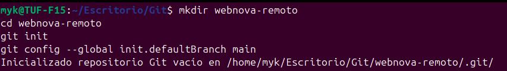
* Crea un archivo llamado equipo.md con el siguiente contenido:
    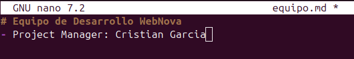
* Haz tu primer commit local:
    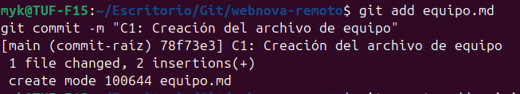
* Ve a tu cuenta de GitHub y crea un nuevo repositorio vacío llamado webnova-remoto (sin README ni .gitignore).
    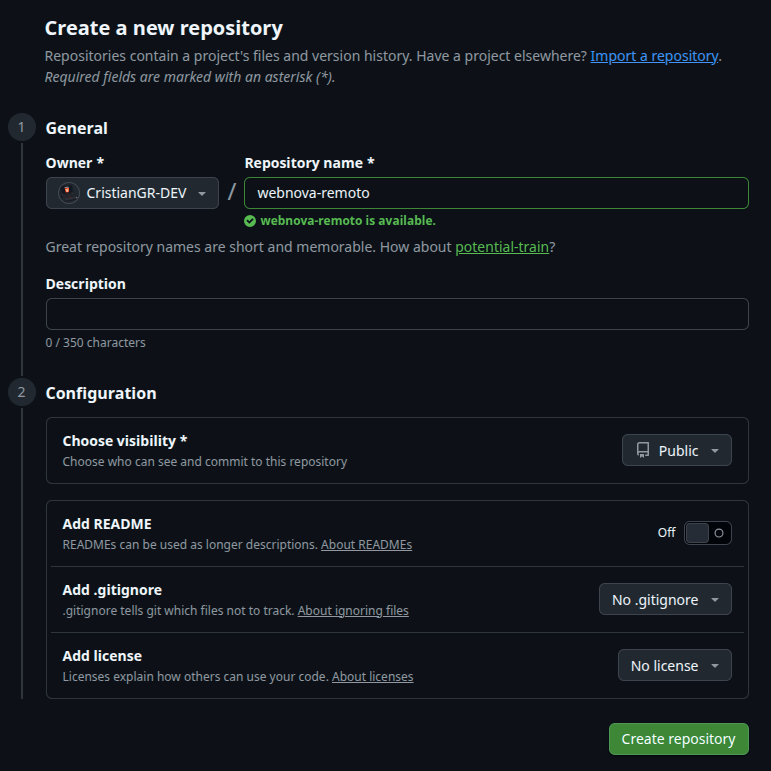
* Copia la URL SSH del repositorio y vincúlalo a tu terminal:
    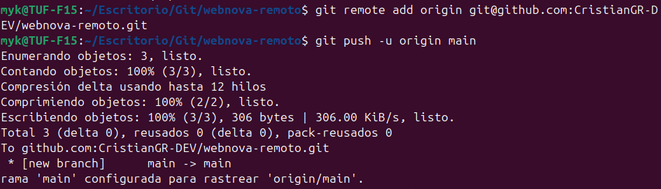

## Fase 2: El Compañero Virtual (Simulación en la Nube)
 * Sin cerrar la terminal, ve al navegador web, entra en tu repositorio de GitHub y abre el archivo equipo.md.
* Haz clic en el icono del lápiz para editarlo directamente en la web.

* Añade una nueva línea al final del archivo simulando el trabajo de tu compañero:

* Haz clic en el botón verde Commit changes..., ponle el mensaje "C2: Añadido Frontend Developer" y confirma. ¡El repositorio remoto acaba de actualizarse!
    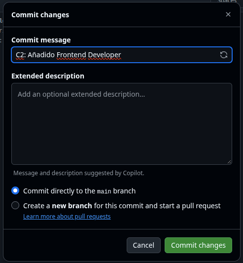

## Fase 3: Tu Trabajo Local (El Choque de Realidad)

* Vuelve a tu terminal (que ahora mismo no sabe que la nube ha cambiado). Abre el archivo equipo.md en tu editor local y añade tu propio cargo en la misma línea donde supuestamente lo hizo tu compañero:

* Haz un commit de tu trabajo en la terminal:
git commit -a -m "C3: Añadido Backend Developer"

* El Choque: Inten
    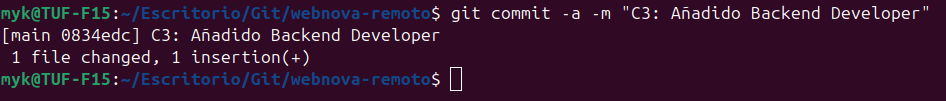
    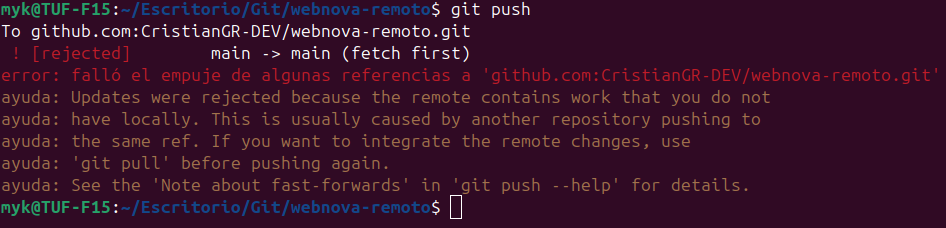

### Tarea 1: Git te bloqueará con un mensaje de error rojo. Lee atentamente la salida de la terminal. ¿Qué palabra clave usa Git para denegar la subida? ¿Qué te sugiere hacer en las líneas de hint:?

## Fase 4: El Rescate y la Resolución
* Para solucionar el problema, debes descargar el código de tu "compañero" y poner tus cambios por encima. Ejecuta:
git pull --rebase

* Git detendrá el proceso indicando un CONFLICTO.
    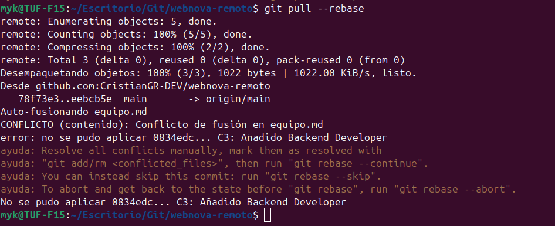
* Abre equipo.md en tu editor de texto. Verás las marcas de conflicto (<<<<<<< HEAD).

* Borra las marcas de Git y fusiona ambas ideas para que el archivo final quede con los tres miembros del equipo:

* Guarda el archivo, indícale a Git que lo has resuelto y continúa el proceso:

* Bash
    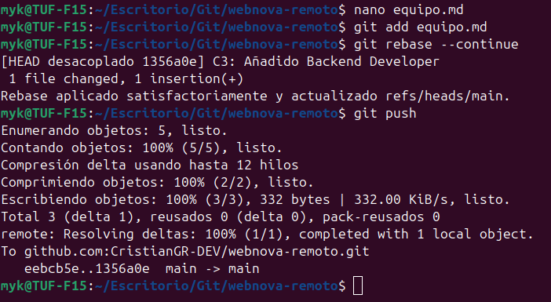
* Una vez finalizado el rescate con éxito, sube el código definitivo a GitHub:
    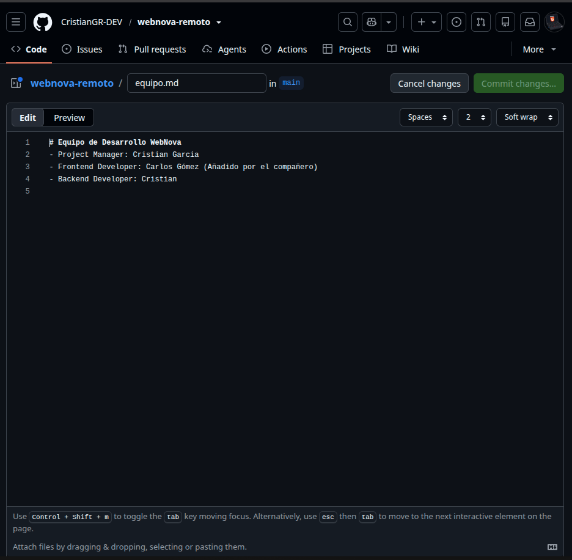
    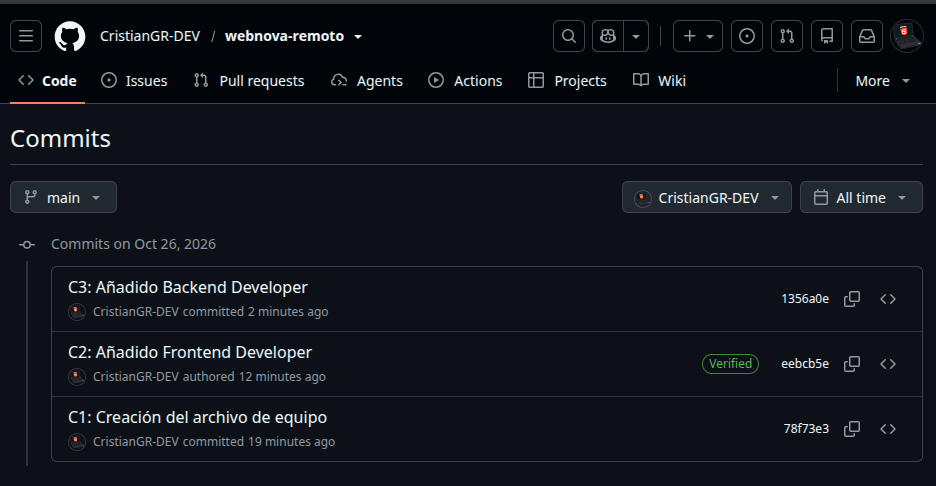

### Tarea 2: Ve a GitHub, recarga la página y comprueba que el archivo muestra a los tres miembros del equipo y que el historial de commits está limpio.
